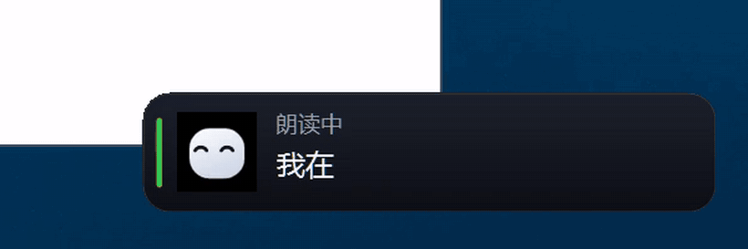

# DSH Voice

Hands-free voice control for a Windows desktop, built on top of **DeepSeek Harness (DSH)**.

Say a wake word — *"你好电脑"* (hello computer) — then speak a command. The agent runs it
against your desktop (open apps, play a stream, search the web, rearrange windows) and
answers out loud.

```
 you:  你好电脑
 orb:  (wakes) 我在
 you:  帮我把抖音最大化
 orb:  (thinking) 已经帮您把抖音最大化了
```

<p align="center">
  
</p>

*Three turns from one recording: wake → "打开计算器" → "算一下一百二十三乘以四十五" →
"把计算器关掉", with the session keeping context between them. Full-length clip:
[docs/demo.mp4](docs/demo.mp4) (silent screen capture).*

## What it does

- **Local speech recognition** — SenseVoiceSmall (int8) + Silero VAD through
  `sherpa-onnx`, running on CPU. No audio leaves the machine.
- **Neural speech output** — Microsoft Edge voices via `edge-tts`.
- **Floating orb** — a small always-on-top chip in the bottom-right corner showing live
  state and your transcribed command. Eyes follow the cursor, blinks, breathes with your
  voice level.
- **Agent execution** — each utterance becomes a DSH session with the Windows-MCP desktop
  tools, so the agent can actually click, type and open things.
- **Session continuity** — consecutive commands reuse one DSH session so the agent keeps
  context, with automatic recovery when the session is locked or missing.
- **Self-defence** — the microphone is muted while the assistant speaks, and wake
  detection pauses entirely whenever the PC is playing audio (CoreAudio peak meter), so a
  video on screen cannot wake the assistant.
- **Survives everything** — the daemon, watchdog and orb are launched through WMI, so
  quitting the DSH app, closing a terminal or logging out of a tool session does not kill
  them. A watchdog restarts a dead daemon within 60 s.

## Requirements

| Component | Notes |
|---|---|
| Windows 10/11 x64 | tested on Windows 11 24H2, 2560×1440 @150% |
| [DeepSeek Harness](https://github.com/deepseek-ai) desktop app | the agent runtime; must be installed and signed in |
| Node.js 20+ | DSH ships one at `%USERPROFILE%\.dsh\dsh-runtimes\...` |
| Python 3.10+ | for `edge-tts`; DSH ships one |
| ffmpeg | for microphone capture and mp3→wav conversion |
| Microphone | any Windows capture device |
| ~250 MB disk | SenseVoice model, downloaded on first run |

## Install

```powershell
# 1. install DSH Desktop and sign in once
# 2. from the release package:
.\install.cmd            # or: pwsh -File installer\install-voice.ps1
# 3. verify microphone, recognition and voice:
pwsh -File first-run.ps1
```

The installer

1. copies the voice layer to `%LOCALAPPDATA%\DSHVoice`,
2. extracts the ASR native modules out of `app.asar` into a standalone runtime
   (so the daemon does not depend on the DSH process tree),
3. downloads the SenseVoice model (size + SHA-256 verified, hf-mirror first),
4. creates a `voice` DSH profile (headless + account auth + Windows-MCP),
5. installs `edge-tts`,
6. registers `HKCU\...\Run` → `start-all.vbs`.

## Architecture

```
 microphone ──ffmpeg(dshow)──► 512-sample frames ──► Silero VAD ──► SenseVoice
                                                                      │
                                                          wake word / command
                                                                      │
                       ┌──────────────────────────────────────────────┤
                       ▼                                              ▼
                orb state.json  ◄── daemon (Node) ──► dsh headless CLI (--json)
                       │                                one session per conversation
                       ▼                                              │
                  orb.ps1 (WinForms)                     ──► TTS (edge-tts)
```

| File | Role |
|---|---|
| `listen.js` | daemon: capture, VAD, ASR, wake matching, CLI submit, TTS, state |
| `match.js` | wake-word and correction helpers (unit-testable, no native deps) |
| `orb.ps1` | floating orb (WinForms + GDI+, `WS_EX_NOACTIVATE`) |
| `speak-edge.py` | edge-tts synthesis → wav → playback |
| `audio-activity.ps1` | CoreAudio peak meter → `audio-activity.json` |
| `watchdog.ps1` | restarts the daemon when its pid goes stale |
| `start-all.vbs` / `start-all.ps1` | WMI-detached launcher for the whole stack |
| `first-run.ps1` | microphone/level/recognition/TTS check wizard |
| `installer/` | installer, packaging script, Inno Setup script |

## Configuration

Copy `config.example.json` to `config.json` and adjust. The important keys:

| Key | Default | Meaning |
|---|---|---|
| `triggers` | `你好电脑`, `嘿电脑`, … | wake phrases |
| `wakeLeadChars` | `2` | how many filler characters may precede the wake word |
| `allowBareWake` | `false` | allow bare "电脑" (dangerous with media audio) |
| `followUpMs` | `0` | window after a reply where no wake word is needed |
| `armTimeoutMs` | `20000` | how long after waking the assistant waits for a command |
| `muteWhenSystemAudio` | `true` | pause wake detection while the PC is playing audio |
| `systemAudioThreshold` | `0.03` | peak level (0–1) that counts as "playing" |
| `tts.voice` | `zh-CN-XiaoxiaoNeural` | any edge-tts voice |
| `corrections` | `{}` | ASR fixes, e.g. `{"yjg":"yjjpaopao"}` |
| `aliases` | `{}` | nicknames → handles, learned from the agent at runtime |

## Troubleshooting

```powershell
cd "$env:LOCALAPPDATA\DSHVoice"

Get-Content daemon.log -Tail 20     # what the daemon heard and did
Get-Content orb.heartbeat           # orb state/visibility
Get-Content watchdog.heartbeat      # is the watchdog alive
Get-Content audio-activity.json     # is the PC playing audio right now

# probe recognition without the microphone:
$env:VOICE_DRY_RUN=1
node listen.js --feed .\test-wake.wav
```

| Symptom | Likely cause |
|---|---|
| no reaction at all | daemon down — check `daemon.pid`, then run `start-all.vbs` |
| orb lights up, no command runs | ASR heard it but the wake word was not at the phrase start |
| "命令执行失败" | the DSH CLI exited non-zero; check the log for the `cli exit=` line |
| nothing while a video plays | by design (`muteWhenSystemAudio`) |
| quiet/incorrect transcript | run `first-run.ps1`; the peak level should be above −25 dBFS |

## Notes on the orb design

The orb's interaction language (cursor-following gaze, blink cadence, thinking saccades,
happy arcs, voice-reactive breathing) is inspired by
[SmoothUI's AI Orb Face](https://smoothui.dev/docs/components/ai-orb-face) and
[Siri Orb](https://smoothui.dev/docs/components/siri-orb). This project is an independent
GDI+ implementation for a WinForms overlay — no code from those components is included.

## License

MIT — see [LICENSE](LICENSE).

Third-party components used at runtime (not bundled):

- [sherpa-onnx](https://github.com/k2-fsa/sherpa-onnx) (Apache-2.0)
- [SenseVoice](https://github.com/FunAudioLLM/SenseVoice) model (see upstream license)
- [edge-tts](https://github.com/rany2/edge-tts) (GPL-3.0, invoked as a subprocess)
- [ffmpeg](https://ffmpeg.org/) (LGPL/GPL depending on build)
- DeepSeek Harness itself is **not** distributed here; the installer expects it to be
  installed separately.
