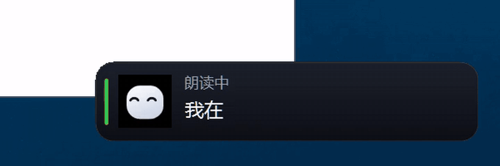

# DSH Voice 中文说明

用语音控制 Windows 桌面,基于 DeepSeek Harness(DSH)。

## 一句话原理

麦克风 → ffmpeg 采集 → Silero VAD → SenseVoice 本地识别 → 命中唤醒词 →
把这句话交给 `dsh headless` 执行 → edge-tts 朗读结果 → 悬浮球同步显示。

## 演示



一轮录屏里的三轮对话:唤醒 →「打开计算器」→「算一下一百二十三乘以四十五」→「把计算器关掉」,
中间不需要重复唤醒,上下文是连贯的。完整版见 [demo.mp4](demo.mp4)(无声录屏)。

## 安装

```powershell
# 1. 先装好 DSH 桌面版并登录一次
# 2. 解压发布包, 双击 install.cmd(或 pwsh -File installer\install-voice.ps1)
# 3. 检查麦克风与识别
pwsh -File first-run.ps1
```

安装器会:复制语音层到 `%LOCALAPPDATA%\DSHVoice`、把 asar 里的语音原生模块抽成独立运行时、
下载 SenseVoice 模型(校验哈希)、创建 `voice` profile、安装 edge-tts、写开机自启。

## 日常使用

```
你: 你好电脑        → 它: 我在
你: 帮我把抖音最大化  → 它: 已经帮您把抖音最大化了
```

- 唤醒词默认 `你好电脑 / 嘿电脑 / 嗨电脑 / 你好助手 / 好电脑`
- 唤醒后 20 秒内说指令,说话会自动续期
- **电脑在放视频/音乐时会自动休眠**(CoreAudio 峰值检测),暂停播放即可唤醒

## 常用配置(`config.json`)

| 键 | 默认 | 说明 |
|---|---|---|
| `triggers` | 你好电脑 等 | 唤醒词 |
| `wakeLeadChars` | 2 | 唤醒词前允许几个杂字 |
| `allowBareWake` | false | 是否允许只喊"电脑" |
| `followUpMs` | 0 | 回答后免唤醒窗口(0=每次都要唤醒词) |
| `armTimeoutMs` | 20000 | 唤醒后等指令的超时 |
| `muteWhenSystemAudio` | true | 系统有声音时暂停唤醒 |
| `systemAudioThreshold` | 0.03 | 判定"在放音"的峰值阈值 |
| `tts.voice` | zh-CN-XiaoxiaoNeural | edge-tts 音色 |

## 排障

```powershell
cd "$env:LOCALAPPDATA\DSHVoice"
Get-Content daemon.log -Tail 20   # 听到了什么、做了什么
Get-Content orb.heartbeat         # 球的状态
Get-Content audio-activity.json   # 当前是否在放音

# 不用麦克风测试识别:
$env:VOICE_DRY_RUN=1
node listen.js --feed .\test-wake.wav
```

| 现象 | 原因 |
|---|---|
| 完全没反应 | 守护进程没起来,运行 `start-all.vbs` |
| 球亮了但没执行 | 唤醒词不在句首 |
| 提示"命令执行失败" | CLI 退出码非 0,看日志里的 `cli exit=` |
| 放视频时不响应 | 设计如此 |
| 识别不准 | 跑 `first-run.ps1` 看峰值电平(应高于 -25 dBFS) |
